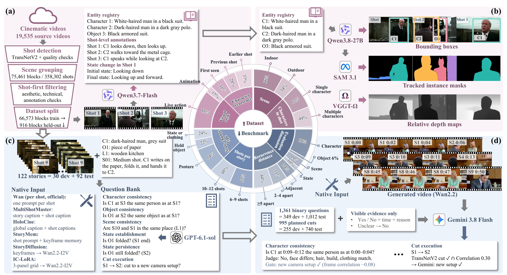

<div align="center">

# CaT-Movie: Balancing Global Planning and Local Rendering for Long Multi-Shot Video Generation

<p>
  <a href="https://jinplu.github.io/CaT-Movie/"></a>
  <a href="https://huggingface.co/collections/JinPLU/cat-movie-6afcfb908ad5cc8c7f1f9206"></a>
  <a href="https://huggingface.co/JinPLU/CaT-Movie"></a>
  <a href="https://huggingface.co/datasets/JinPLU/CaT-Movie-Data"></a>
  <a href="https://huggingface.co/datasets/JinPLU/CaT-MBench"></a>
  <a href="LICENSE"></a>
  <!-- paper-link -->
</p>

<p>
  <strong>Jinpeng Lu</strong><sup>*</sup> ·
  <strong>Haoyuan Shi</strong><sup>*</sup> ·
  <strong>Yuanshen Guan</strong> ·
  <strong>Jiyuan Xia</strong> ·
  <strong>Bin Wu</strong> ·
  <strong>Yinda Chen</strong> ·
  <strong>Zhiwei Xiong</strong>
  <br>
  University of Science and Technology of China &nbsp;·&nbsp; <sup>*</sup>Equal contribution
</p>

<p>
  
</p>

</div>

**TL;DR:** **CaT-Movie** decouples long multi-shot video generation into a training-free **Global Storyboard Planner** (`Qwen3.8-27B` + deterministic state compiler) and a **Local Window Renderer** (`Wan2.2-TI2V-5B`, `704p`, `24 fps`) with **shot-wise cross-attention**, **reference-routed sparse self-attention**, and storyboard-indexed **anchor recall**—executing planned cuts cleanly while preserving entities and states across window boundaries.

---

## Overview

Existing multi-shot generators face an uncomfortable trade-off: **per-shot** models cut faithfully yet forget entities, **joint window** models drift across window boundaries, and **similarity/recency memory** often copies prior camera framing across cuts. **CaT-Movie** aligns planning, frame recall, and rendering onto a single **structured storyboard**:

- **Global Storyboard Planner (`Qwen3.8-27B` + Prompt Compiler):** Expands `synopsis`, `paragraph`, or `shots` requests into persistent entity registries (`Character N`, `Object N`, `Location N`), per-shot camera/state plans, and compiled prompts (`c_k`), carrying attire and held-item updates forward across generation windows (`8 s` training / `7 s` test cap).
- **Storyboard-Indexed Anchor Recall (`plan_selection`):** Queries the storyboard for each returning entity's clearest prior **anchor view** after its latest planned state/attire change (plus location views, up to `10` source shots/window).
- **Local Window Renderer (`Wan2.2-TI2V-5B`):** Isolates per-shot text via **shot-wise cross-attention** and applies **reference-routed sparse self-attention** (`holocine_first_frame` + `routed_self_only_v1`) over co-generated first latent frames and entity-routed references carrying **identity lines** (`frame_entities_v1`).

---

## Release Ecosystem

All checkpoints, datasets, caches, source clips, and benchmark assets live in the **[CaT-Movie Hugging Face Collection](https://huggingface.co/collections/JinPLU/cat-movie-6afcfb908ad5cc8c7f1f9206)** (code: `Apache-2.0`; models, data, caches & benchmarks: `CC BY-NC-SA 4.0` for non-commercial research):

| Resource | Tier | Summary | Link |
|---|---|---|---|
| **Codebase** | **Core** | Planner, renderer training/inference, data curation & `CaT-MBench` (`mspc`) | [GitHub](https://github.com/JinPLu/CaT-Movie) |
| **CaT-Movie-5B** | **Core** | Finetuned `Wan2.2-TI2V-5B` renderer weights (`step-3000.safetensors`, `9.44 GiB`) | [`JinPLU/CaT-Movie`](https://huggingface.co/JinPLU/CaT-Movie) |
| **CaT-Movie-Data** | **Core** | `75,461` scene blocks (`358,302` shots), `Qwen3.7-Flash` schemas, grounding & `96,000` train windows | [`JinPLU/CaT-Movie-Data`](https://huggingface.co/datasets/JinPLU/CaT-Movie-Data) |
| **CaT-Movie-T5-Cache** | **Core** | Precomputed `umT5-XXL` BF16 text context tensors (`332,516` unique prompts) | [`JinPLU/CaT-Movie-T5-Cache`](https://huggingface.co/datasets/JinPLU/CaT-Movie-T5-Cache) |
| **CaT-Movie-VAE-Caches** | **Core** | Precomputed target VAE latents (`Wan2.2 704p` `104,534` + `Wan2.1 480p` `103,365` shots) | [`JinPLU/CaT-Movie-VAE-Caches`](https://huggingface.co/datasets/JinPLU/CaT-Movie-VAE-Caches) |
| **Source Videos** | **Supporting** | Complete `18,173` block-yielding source MP4 clips (`CineDance`, `CinePile-T2V`, `MovieChat-1K`) | [`JinPLU/CaT-Movie-Source-Videos`](https://huggingface.co/datasets/JinPLU/CaT-Movie-Source-Videos) |
| **CaT-MBench** | **Core** | `122` stories (`30` dev / `92` test), `GPT-6.1-sol` VQA (`1,012` test items), verdicts & `557` human labels | [`JinPLU/CaT-MBench`](https://huggingface.co/datasets/JinPLU/CaT-MBench) |
| **CaT-MBench-Videos** | **Supporting** | All `736` generated test videos (`92` stories × `8` methods, `13.65 GiB`) | [`JinPLU/CaT-MBench-Videos`](https://huggingface.co/datasets/JinPLU/CaT-MBench-Videos) |
| **Author Labels** | **Archive** | Early Nov 6 calibration archive *(superseded by `CaT-MBench/human/`)* | [`JinPLU/CaT-MBench-Author-Labels`](https://huggingface.co/datasets/JinPLU/CaT-MBench-Author-Labels) |

---

## Dataset & Benchmark (`CaT-Movie-Data` & `CaT-MBench`)

One film pool and one unified storyboard schema back both training (**Film Storyboard Dataset**) and evaluation (**`CaT-MBench`**):

<p align="center">
  
</p>

- **Film Storyboard Dataset (`JinPLU/CaT-Movie-Data`):** From `19,535` source videos (`18,173` clips yielding blocks), TransNetV2 + quality/cut screening builds **`75,461` scene blocks** (`358,302` shots, `332.8 hours`) annotated by **Qwen3.7-Flash** with three request tiers (`synopsis`, `paragraph`, `shots`) and within-shot transitions (`22.6%` of shots). Shot-first filtering retains **`+28.1%`** more usable shots (`67,489` usable blocks → `66,573` train / `916` held-out; `96,000` training windows), grounded via **Qwen3.8-27B** boxes → **SAM 3.1** masks → **VGGT-Ω** relative depth. *(See [dataset card](https://huggingface.co/datasets/JinPLU/CaT-Movie-Data) for schema details.)*
- **Cut-Gated Story Benchmark (`JinPLU/CaT-MBench`):** Evaluates **`122` held-out stories** (`30` dev / `92` test; `6–12` shots, `≤ 60 s`) on **`740` planned test cuts** (`Cut F1` @ `0.125 s`; `Execution` over `674` setup-changing cuts via `±0.5 s` TransNetV2 + `Gemini 3.8 Flash` new-setup check) and **`1,012` test / `349` dev** questions from `GPT-6.1-sol`. Consistency (`Character` / `Object` / `Scene`, 6 native-res frames/pair) and `Persist` checks behind a failed cut gate receive `0` credit; state checks (`Establish` / `Persist`) run whole-video at `2 fps` via **Gemini 3.8 Flash** (`κ = 0.704`, balanced accuracy `0.851` on `557` reviewed blind human items vs. ViCLIP AUC `0.49–0.70`). *(See [benchmark card](https://huggingface.co/datasets/JinPLU/CaT-MBench) for full protocol.)*

| Cut-Gated Evaluation (`CaT-MBench`) | Breaking the Baseline Pareto Frontier (`92` Test Stories) |
| :---: | :---: |
|  |  |

### Main Comparison on `CaT-MBench` (`92` Test Stories)

Evaluated with seed `42` across all methods (`Table 1`): baselines convert annotated **reference storyboards** into native prompt formats, whereas **CaT-Movie** renders its **Qwen3.8-27B** planner's storyboard generated solely from the `shots` request (best **bold**, second *italic*; baseline adapters in [`src/mspc/comparison_methods/`](src/mspc/comparison_methods/README.md)):

| Method (Video Base & Regime) | Cut F1 ↑ | Exec. ↑ | Char. ↑ | Obj. ↑ | Scene ↑ | Est. ↑ | Persist ↑ | Align. ↑ | Avg. ↑ |
|---|---:|---:|---:|---:|---:|---:|---:|---:|---:|
| Wan2.1, per shot *(1.3B, per-shot)* | *0.998* | *0.994* | 0.219 | 0.169 | 0.310 | 0.274 | 0.694 | 0.181 | 0.474 |
| Wan2.2, per shot *(5B, per-shot)* | **0.999** | **0.996** | 0.227 | 0.275 | 0.310 | 0.387 | *0.701* | 0.174 | 0.497 |
| StoryMem *(A14B-I2V, per-shot)* | 0.928 | 0.719 | *0.631* | 0.453 | **0.687** | 0.484 | 0.545 | 0.179 | 0.527 |
| StoryDiffusion *(A14B-I2V, per-shot)* | 0.905 | 0.825 | 0.300 | 0.265 | 0.245 | *0.597* | 0.535 | 0.171 | 0.468 |
| IC-LoRA *(A14B-I2V, per-shot)* | 0.976 | 0.961 | 0.168 | 0.133 | 0.406 | 0.452 | 0.663 | 0.176 | 0.484 |
| MultiShotMaster *(1.3B, joint)* | 0.994 | 0.990 | 0.538 | 0.254 | 0.582 | 0.371 | 0.587 | 0.178 | 0.527 |
| HoloCine *(A14B-T2V, joint)* | 0.748 | 0.967 | 0.517 | **0.512** | 0.586 | **0.694** | 0.691 | **0.195** | *0.571* |
| **CaT-Movie (Ours)** *(5B, joint)* | 0.995 | 0.974 | **0.651** | *0.497* | *0.630* | 0.468 | **0.785** | *0.186* | **0.597** |

*(Bases: `Wan2.1-T2V-1.3B`, `Wan2.2-TI2V-5B`, `Wan2.2-I2V-A14B`, `Wan2.2-T2V-A14B`. Columns shorten `Execution`, `Character`, `Object`, `Scene`, `Establish`, `Text Alignment`.)*

---

## Quickstart: Setup & Single-Story Inference

### 1. Install & download weights

```bash
git clone https://github.com/JinPLu/CaT-Movie.git && cd CaT-Movie
uv sync && source .venv/bin/activate   # add --extra gpu-wan for GPU rendering/training

export MSPC_SHARED_ROOT=/path/to/cat_movie_workspace
export MSPC_CODE_ROOT="$(pwd)"

hf download Wan-AI/Wan2.2-TI2V-5B --local-dir "$MSPC_SHARED_ROOT/checkpoints/Wan2.2-TI2V-5B"
hf download JinPLU/CaT-Movie step-3000.safetensors --local-dir "$MSPC_SHARED_ROOT/checkpoints/CaT-Movie"
```

### 2. Render a story (`704p`, `24 fps`)

Always invoke `run/render_story.py` (rather than stock Wan2.2 `generate.py`) so CaT-Movie's window attention and negative-RoPE routed references are enabled (`--prepare-only` runs CPU preflight first):

```bash
PYTHONPATH=.:src python run/render_story.py \
  --config configs/infer/cat_movie_5b.py \
  --storyboard examples/sample_storyboard.json \
  --story-id cinedance-008935-b0001-shot01 \
  --output outputs/demo/cinedance-008935-b0001-shot01 \
  --seed 42 --segment-seed-stride 1009 --segment-max-shots none \
  --segment-max-frames 112 --history-policy plan_selection
```

<details>
<summary>Optional extras, auxiliary environments & unit tests (`src/mspc`)</summary>

> The Python package lives under `src/mspc/` for backwards compatibility with existing configs and checkpoints; see [`THIRD_PARTY_NOTICES.md`](THIRD_PARTY_NOTICES.md) for upstream licenses (`Wan2.2`, `DiffSynth-Studio`, `MultiShotMaster`).

| Extra / Env | Purpose |
|---|---|
| `uv sync --extra api` | Storyboard planner, `GPT-6.1-sol` question writer & `Gemini 3.8 Flash` evaluation |
| `uv sync --extra gpu-wan` | GPU training and `Wan2.2-TI2V-5B` multi-shot rendering |
| [`environments/planner_inference/`](environments/planner_inference/) | Serving `Qwen3.8-27B` / `Qwen3.5-9B` planners via vLLM (`run/vllm_serve.py`) |
| [`environments/person_tools/`](environments/person_tools/) & [`environments/moge2/`](environments/moge2/) | Entity grounding (**SAM 3.1** masks + **VGGT-Ω** depth in `spatial_layer.py`; MoGe-2 layout helper) |
| [`src/mspc/comparison_methods/`](src/mspc/comparison_methods/README.md) | Baseline runners & scoring environments |

```bash
MSPC_SHARED_ROOT=/tmp/mspc_shared_root MSPC_CODE_ROOT="$(pwd)" PYTHONPATH=src pytest -q
```

</details>

---

## Evaluation & Reproduction

```bash
# Recompute exact Table 1 scores & film-clustered paired bootstrap CIs from CaT-MBench verdicts (CPU only)
hf download JinPLU/CaT-MBench --repo-type dataset --local-dir data/cat_mbench

PYTHONPATH=src python -m mspc.evaluation.checklist_scoring readout-v17 \
  --bank data/cat_mbench/questions.v17.json --cut-items data/cat_mbench/cut_items.v17.json \
  --cut-root data/cat_mbench/judge/cut --pair-root data/cat_mbench/judge/pairs \
  --video-root data/cat_mbench/judge/video \
  --rows wan22-final-test92-planner-27b-seed42 test92-holocine test92-multishotmaster \
         test92-ic-lora test92-storydiffusion test92-storymem \
         test92-official-wan test92-wan21-1p3b-native \
  --answer-scope existing --output outputs/eval/readout_v17_recomputed.json

PYTHONPATH=src python -m mspc.evaluation.checklist_scoring paired \
  --readout outputs/eval/readout_v17_recomputed.json \
  --requests configs/benchmark/story_requests_v4.json \
  --pair test92-holocine wan22-final-test92-planner-27b-seed42 \
  --output outputs/eval/paired_vs_holocine.json
```

<details>
<summary>Score your own videos & verify baseline deployments</summary>

Download all `736` baseline/ours videos optionally via `hf download JinPLU/CaT-MBench-Videos --repo-type dataset --local-dir data/cat_mbench_videos`. To evaluate new videos under the `gemini-3.8-flash` cut-gated protocol:
1. Extract TransNetV2 cuts: `mspc.evaluation.checklist_scoring detect-cuts`.
2. Score cut gates: `mspc.evaluation.cut_execution` (`prepare` → `submit` → `collect`).
3. Score consistency pairs (`6` frames) & whole-video states (`2 fps`): `mspc.evaluation.consistency_pair_batch` + `mspc.evaluation.gemini_checklist_batch`, then aggregate with `checklist_scoring readout-v17 --answer-scope complete`.
4. Verify baseline deployment assets (`8` rows): `PYTHONPATH=src python -m mspc.comparison_methods.inspect_deployment`.

</details>

<details>
<summary>Training, Paper Table 2 ablations, full data/caches/videos & Codebase Map</summary>

### Plan & render the 92 `CaT-MBench` test stories

Using `configs/infer/planner_renderer_test92.json` and a vLLM planner server (`run/vllm_serve.py --config configs/serving/vllm_planner_qwen38_27b.yaml`):

```bash
PYTHONPATH=src python -m mspc.benchmark.layout_baseline write-planner-plans \
  --conditions configs/infer/planner_renderer_test92.json --records path/to/planner_records.jsonl
PYTHONPATH=src python -m mspc.benchmark.layout_baseline prepare \
  --conditions configs/infer/planner_renderer_test92.json
```

### Training & Paper Table 2 Ablation Configs

Launch via `run/train.sh <CONFIG>` after restoring caches below (or regenerating via `tools/data/build_shot_targets.py` and `configs/runtime/wan22_final_long_single_shot_targets.py`):
- [`configs/train/renderer_wan22_final.py`](configs/train/renderer_wan22_final.py) — Full **CaT-Movie** model (`Step 3000` weights released)
- [`configs/train/renderer_wan22_final_fixed_role_rows.py`](configs/train/renderer_wan22_final_fixed_role_rows.py) — Table 2: **Trained without identity lines** (`fixed_role_v1`)
- [`configs/train/renderer_wan22_final_window_shared.py`](configs/train/renderer_wan22_final_window_shared.py) — Table 2: **Trained without routing** (`window_shared_self_only_v1`)
- [`configs/train/renderer_wan22_final_without_references.py`](configs/train/renderer_wan22_final_without_references.py) — Table 2: **Trained without references** (`memory_prefix = None`)
- [`configs/train/renderer_joint_wan22_720p.py`](configs/train/renderer_joint_wan22_720p.py) — Joint `704p` baseline config

### Download Full Training Data, Caches & Source Videos

```bash
export MSPC_SHARED_ROOT=/path/to/cat_movie_workspace
hf download JinPLU/CaT-Movie-Data --repo-type dataset --local-dir "$MSPC_SHARED_ROOT/releases/CaT-Movie-Data"
hf download JinPLU/CaT-Movie-T5-Cache --repo-type dataset --local-dir "$MSPC_SHARED_ROOT/releases/CaT-Movie-T5-Cache"
hf download JinPLU/CaT-Movie-VAE-Caches --repo-type dataset --local-dir "$MSPC_SHARED_ROOT/releases/CaT-Movie-VAE-Caches"
hf download JinPLU/CaT-Movie-Source-Videos --repo-type dataset --local-dir "$MSPC_SHARED_ROOT/releases/CaT-Movie-Source-Videos"
```

Each dataset includes its restoration script (`restore_training_inputs.py`, `restore_t5_cache.py`, `restore_vae_caches.py`, `restore_source_videos.py`) to unpack shards and expand `${MSPC_SHARED_ROOT}` paths.

### Codebase Entrypoint Map (Appendix Table S8)

| Stage | Entry Point(s) |
|---|---|
| **Shot screening & blocks** | [`tools/data/preprocess_sources.py`](tools/data/preprocess_sources.py), [`score_shots.py`](tools/data/score_shots.py), [`quality_lines.py`](tools/data/quality_lines.py), [`build_block_members.py`](tools/data/build_block_members.py) |
| **Annotation (`Qwen3.7-Flash`) & grounding** | [`tools/data/annotate_windows.py`](tools/data/annotate_windows.py), [`validate_annotations.py`](tools/data/validate_annotations.py), [`spatial_layer.py`](tools/data/spatial_layer.py) |
| **Windows & target/T5 caches** | [`tools/data/select_training_windows.py`](tools/data/select_training_windows.py), [`build_shot_targets.py`](tools/data/build_shot_targets.py), [`run/precompute.sh`](run/precompute.sh) |
| **Planner (`Qwen3.8-27B`) & text eval (`DeepSeek-V4.1-Flash`)** | [`tools/run/planner_form_plans.py`](tools/run/planner_form_plans.py), [`run/vllm_serve.py`](run/vllm_serve.py), [`planner_state_checks.py`](src/mspc/evaluation/planner_state_checks.py), [`shot_text_information.py`](src/mspc/evaluation/shot_text_information.py) |
| **VQA, judges & bootstrap CIs** | [`question_writer.py`](src/mspc/evaluation/question_writer.py), [`cut_execution.py`](src/mspc/evaluation/cut_execution.py), [`consistency_pair_batch.py`](src/mspc/evaluation/consistency_pair_batch.py), [`gemini_checklist_batch.py`](src/mspc/evaluation/gemini_checklist_batch.py), [`checklist_scoring.py`](src/mspc/evaluation/checklist_scoring.py), [`paired_bootstrap.py`](src/mspc/evaluation/paired_bootstrap.py), [`planned_cut_accuracy.py`](tools/analysis/planned_cut_accuracy.py), [`benchmark.py`](src/mspc/evaluation/benchmark.py) |

</details>

---

## License, Acknowledgements & Citation

- **License:** Code under [Apache-2.0](LICENSE) (see [`THIRD_PARTY_NOTICES.md`](THIRD_PARTY_NOTICES.md)); weights, datasets, caches, source clips, and benchmarks under **CC BY-NC-SA 4.0** for non-commercial academic research (`Wan2.2-TI2V-5B` is Apache-2.0).
- **Acknowledgements:** Built on [Wan2.2](https://github.com/Wan-Video/Wan2.2), [DiffSynth-Studio](https://github.com/modelscope/DiffSynth-Studio), [Qwen](https://github.com/QwenLM), [MultiShotMaster](https://github.com/KlingAIResearch/MultiShotMaster), [CinePile](https://huggingface.co/datasets/CinematicT2vData/raw_videos_batched), [MovieChat-1K](https://huggingface.co/datasets/Enxin/MovieChat-1K-test) ([train](https://huggingface.co/datasets/Enxin/MovieChat-1K_train)), and [CineDance](https://huggingface.co/datasets/CineDance/CineDance_01).

```bibtex
@misc{catmovie2026,
  title         = {CaT-Movie: Balancing Global Planning and Local Rendering for Long Multi-Shot Video Generation},
  author        = {Jinpeng Lu and Haoyuan Shi and Yuanshen Guan and Jiyuan Xia and Bin Wu and Yinda Chen and Zhiwei Xiong},
  year          = {2026},
  url           = {https://jinplu.github.io/CaT-Movie/}
}
```
