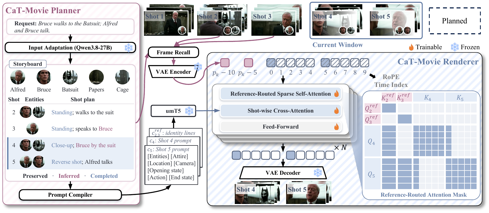
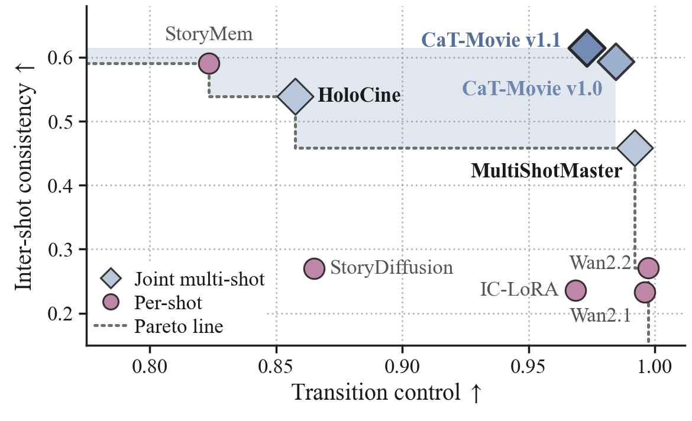
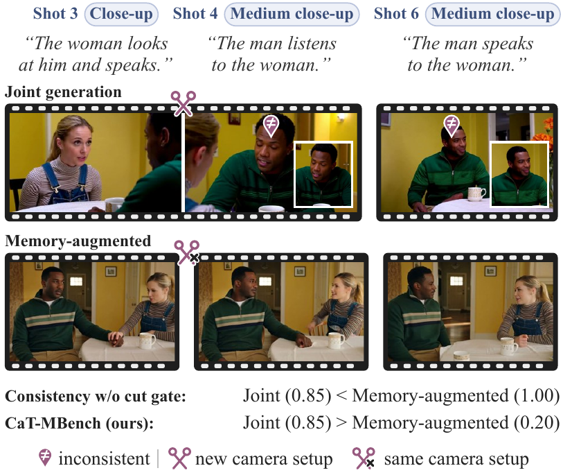

<div align="center">

# CaT-Movie: Balancing Global Planning and Local Rendering for Long Multi-Shot Video Generation

<p>
  <a href="https://jinplu.github.io/CaT-Movie/"></a>
  <a href="https://huggingface.co/collections/JinPLU/cat-movie-6afcfb908ad5cc8c7f1f9206"></a>
  <a href="https://huggingface.co/JinPLU/CaT-Movie"></a>
  <a href="https://huggingface.co/JinPLU/CaT-Movie-Data"></a>
  <a href="https://huggingface.co/JinPLU/CaT-MBench"></a>
  <a href="LICENSE"></a>
  <!-- paper-link -->
</p>

<p>
  <strong>Jinpeng Lu</strong><sup>*</sup> ·
  <strong>Haoyuan Shi</strong><sup>*</sup> ·
  <strong>Yuanshen Guan</strong> ·
  <strong>Jiyuan Xia</strong> ·
  <strong>Bin Wu</strong> ·
  <strong>Yinda Chen</strong> ·
  <strong>Zhiwei Xiong</strong>
</p>
<p>
  University of Science and Technology of China &nbsp;·&nbsp; <sup>*</sup>Equal contribution
</p>

<p>
  
</p>

</div>

---

## Overview

Existing multi-shot video generation approaches sit on an uncomfortable trade-off between **transition control** and **inter-shot consistency**:

- **Per-shot generation** executes cuts faithfully but drifts in identity, attire, objects, and scene state across shots.
- **Joint multi-shot synthesis** models short windows together, often softening or dropping planned cuts and scaling poorly to long stories.
- **Naive visual memory** over-attends to retrieved frames, encouraging background copying over planned compositional changes.

**CaT-Movie** decouples global narrative planning from local multi-shot rendering around **three design principles**:

1. **Code-Maintained Storyboard Planning.** A structured planner (**Qwen3.8-27B** by default) plans shots with explicit entity registries, attire/object persistence, shot-level opening/action/end states, and layout cues—eliminating long-horizon narrative drift before any pixel is synthesized.
2. **Localized Prompt Compilation & Frame Recall.** Each shot receives its own localized text prompt and selectively recalled keyframe references anchored with negative temporal RoPE indices.
3. **Reference-Routed Sparse Renderer (704p, 24 fps).** Built on **Wan2.2-TI2V-5B**, the renderer pairs first-frame cross-shot sparse attention (`holocine_first_frame`) with entity-routed, self-only reference attention (`routed_self_only_v1`) and shot-wise cross-attention, keeping transitions crisp while carrying identities across long shot gaps.

<p align="center">
  
</p>

---

## Release Resources

All weights, annotations, benchmarks, and generated comparison videos are organized in the **[CaT-Movie Hugging Face Collection](https://huggingface.co/collections/JinPLU/cat-movie-6afcfb908ad5cc8c7f1f9206)**:

| Resource | Tier | Description | Link |
|---|---|---|---|
| **CaT-Movie Codebase** | **Core** | Training, inference, data construction, planner & `CaT-MBench` evaluation (`mspc` package) | [GitHub](https://github.com/JinPLu/CaT-Movie) (Apache-2.0) |
| **CaT-Movie-5B Weights** | **Core** | Finetuned `Wan2.2-TI2V-5B` multi-shot renderer (`step-3000.safetensors`, 9.44 GiB) | [`JinPLU/CaT-Movie`](https://huggingface.co/JinPLU/CaT-Movie) |
| **CaT-Movie-Data** | **Core** | 75,461 annotated multi-shot blocks, raw annotations (`story_annotation_v2`), `96,000` training samples, member manifests & text admission tables | [`JinPLU/CaT-Movie-Data`](https://huggingface.co/datasets/JinPLU/CaT-Movie-Data) |
| **CaT-Movie-T5-Cache** | **Core** | Precomputed `umT5-XXL` BF16 text context tensors (`332,516` unique deduplicated prompts covering Wan2.2 final, 3 ablations & Wan2.1 480p) | [`JinPLU/CaT-Movie-T5-Cache`](https://huggingface.co/datasets/JinPLU/CaT-Movie-T5-Cache) |
| **CaT-Movie-VAE-Caches** | **Core** | Precomputed target VAE latents (`Wan2.2 704p` `104,534` shots / `538.4 GB` + `Wan2.1 480p` `103,365` shots / `197.9 GB`) | [`JinPLU/CaT-Movie-VAE-Caches`](https://huggingface.co/datasets/JinPLU/CaT-Movie-VAE-Caches) |
| **CaT-Movie-Source-Videos** | **Supporting** | Complete `18,173` referenced source MP4 clips across CineDance, CinePile-T2V & MovieChat-1K (non-commercial academic research release) | [`JinPLU/CaT-Movie-Source-Videos`](https://huggingface.co/datasets/JinPLU/CaT-Movie-Source-Videos) |
| **CaT-MBench** | **Core** | 122 stories (`92` test / `30` dev), cut-gated multi-shot VQA (`1,012` test / `349` dev scored items), judge verdicts & dual-annotator human labels | [`JinPLU/CaT-MBench`](https://huggingface.co/datasets/JinPLU/CaT-MBench) |
| **CaT-MBench-Videos** | **Supporting** | All `736` generated 92-story videos across `8` evaluated methods (`13.65 GiB`) | [`JinPLU/CaT-MBench-Videos`](https://huggingface.co/datasets/JinPLU/CaT-MBench-Videos) |
| **CaT-MBench-Author-Labels** | **Archive** | Nov 6 single-author VLM-judge calibration archive *(superseded by `CaT-MBench/human/`)* | [`JinPLU/CaT-MBench-Author-Labels`](https://huggingface.co/datasets/JinPLU/CaT-MBench-Author-Labels) |

> **Full research open-source release:** All checkpoints, multi-shot annotations, source video clips, precomputed VAE latent target caches, and `umT5-XXL` text caches are publicly released on Hugging Face strictly for **non-commercial academic research** (`CC BY-NC-SA 4.0` where upstream ShareAlike applies; codebase under `Apache-2.0`).

---

## CaT-MBench Benchmark

[**`JinPLU/CaT-MBench`**](https://huggingface.co/datasets/JinPLU/CaT-MBench) evaluates long multi-shot story generation (`122` stories: `92` test, `30` dev; `6–12` shots, up to `60 s` per story) under an explicit **transition-conditioned consistency protocol**.

<p align="center">
  
</p>

### Why Cut-Gated Evaluation?

Naive cross-shot similarity rewards models that ignore planned transitions and repeat identical backgrounds or camera setups across shots. `CaT-MBench` eliminates this failure mode with a strict **two-stage evaluation pipeline** implemented in [`src/mspc/evaluation/`](src/mspc/evaluation/):

1. **Cut Execution Gate (`mspc.evaluation.cut_execution`):** Detects shot boundaries with TransNetV2 (`±0.5 s` tolerance, `Cut F1`), filters near-identical camera setups via mid-frame grayscale pixel correlation (`corr >= 0.9`), and verifies ambiguous pairs with a 4-frame native-resolution VLM camera-setup check (`Cut Exec.`). Cross-shot consistency questions receive positive credit only when the cut premise genuinely holds.
2. **Fine-Grained VLM Question Answering (`consistency_pair_batch` & `gemini_checklist_batch`):**
   - **Character, Object & Scene consistency** use native-resolution 6-frame shot-pair queries (`first`, `middle`, `last` frame per shot) to preserve small-detail identity cues.
   - **Event & State transitions (`Establish` / `Persist`)** use whole-video evaluation sampled at **`2 fps`** with per-shot timestamps via Gemini 2.5 Flash.

### Benchmark Composition & Human Calibration

- **Three Request Tiers (`stories.json`):** `synopsis`, `scene`, and `shots` (standard renderer protocol), paired with annotated reference storyboards in `configs/benchmark/`.
- **Question Bank (`questions.v17.json`):** **`1,012` test** scored questions (`662` Character, `65` Object, `194` Scene, `44` Establish `[≤ 2 shots]`, `47` Persist `[> 2 shots]`) plus **`545` auxiliary monitoring items** (`426` event, `27` state-other, `92` style), alongside **`349` dev** scored questions.
- **Human Agreement (`human/human_labels.json` & `human/agreement.json`):** `791` dual-annotator blind items with **`100%` (`185 / 185`, $\kappa = 1.0$) adjudicated inter-annotator overlap** and **`85.3%` judge-vs-human agreement** ($\kappa = 0.70$, 95% CI `[0.64, 0.77]`, balanced accuracy `0.851` across `557` calibrated items).

### Main Results on `CaT-MBench` (`92` Test Stories)

Evaluated using identical reference storyboards and seed `42` across all baselines (baseline runners and pinned commits live in [`src/mspc/comparison_methods/`](src/mspc/comparison_methods/README.md)). Best per column is **bold**; second best is *italic*.

| Method | Backbone | Cut F1 ↑ | Cut Exec. ↑ | Character ↑ | Object ↑ | Scene ↑ | Establish ↑ | Persist ↑ | Text Align. ↑ | Avg. ↑ |
|---|---|---:|---:|---:|---:|---:|---:|---:|---:|---:|
| Wan2.1, per shot | Wan2.1-T2V-1.3B | 0.998 | 0.994 | 0.219 | 0.169 | 0.310 | 0.274 | 0.694 | 0.181 | 0.474 |
| Wan2.2, per shot | Wan2.2-TI2V-5B | **0.999** | **0.996** | 0.227 | 0.275 | 0.310 | 0.387 | *0.701* | 0.174 | 0.497 |
| StoryMem | Wan2.2-I2V-A14B | 0.928 | 0.719 | *0.631* | 0.453 | **0.687** | 0.484 | 0.545 | 0.179 | 0.527 |
| StoryDiffusion | Wan2.2-I2V-A14B | 0.905 | 0.825 | 0.300 | 0.265 | 0.245 | *0.597* | 0.535 | 0.171 | 0.468 |
| IC-LoRA | Wan2.2-I2V-A14B | 0.976 | 0.961 | 0.168 | 0.133 | 0.406 | 0.452 | 0.663 | 0.176 | 0.484 |
| MultiShotMaster | Wan2.1-T2V-1.3B | 0.994 | 0.990 | 0.538 | 0.254 | 0.582 | 0.371 | 0.587 | 0.178 | 0.527 |
| HoloCine | Wan2.2-T2V-A14B | 0.748 | 0.967 | 0.517 | **0.512** | 0.586 | **0.694** | 0.691 | **0.195** | *0.571* |
| **CaT-Movie (Ours)** | Wan2.2-TI2V-5B | 0.995 | 0.974 | **0.651** | *0.497* | *0.630* | 0.468 | **0.785** | *0.186* | **0.597** |

### Running `CaT-MBench` Evaluation

```bash
# 1. Download CaT-MBench metadata, judge verdicts & (optionally) all 736 videos
hf download JinPLU/CaT-MBench --repo-type dataset --local-dir data/cat_mbench
hf download JinPLU/CaT-MBench-Videos --repo-type dataset --local-dir data/cat_mbench_videos

# 2. Recompute exact Table 1 scores & film-clustered paired bootstrap CIs (CPU only)
PYTHONPATH=src python -m mspc.evaluation.checklist_scoring readout-v17 \
  --bank data/cat_mbench/questions.v17.json \
  --cut-items data/cat_mbench/cut_items.v17.json \
  --cut-root data/cat_mbench/judge/cut \
  --pair-root data/cat_mbench/judge/pairs \
  --video-root data/cat_mbench/judge/video \
  --rows wan22-final-test92-planner-27b-seed42 test92-holocine test92-multishotmaster \
         test92-ic-lora test92-storydiffusion test92-storymem \
         test92-official-wan test92-wan21-1p3b-native \
  --answer-scope existing \
  --output outputs/eval/readout_v17_recomputed.json

PYTHONPATH=src python -m mspc.evaluation.checklist_scoring paired \
  --readout outputs/eval/readout_v17_recomputed.json \
  --requests configs/benchmark/story_requests_v4.json \
  --pair test92-holocine wan22-final-test92-planner-27b-seed42 \
  --output outputs/eval/paired_vs_holocine.json
```

To score **your own model's** generated videos under the identical two-stage judge protocol:
1. Run `mspc.evaluation.checklist_scoring detect-cuts` to extract TransNetV2 shot boundaries.
2. Run `mspc.evaluation.cut_execution` (`prepare` -> `submit` -> `collect`) for cut-gate verdicts.
3. Run `mspc.evaluation.consistency_pair_batch` (`character` / `object` / `scene`) and `mspc.evaluation.gemini_checklist_batch` (`event` / `state`), then aggregate with `checklist_scoring readout-v17 --answer-scope complete`.
4. To reproduce the `8` baseline comparison methods in [`src/mspc/comparison_methods/`](src/mspc/comparison_methods/README.md), verify deployment assets first with `PYTHONPATH=src python -m mspc.comparison_methods.inspect_deployment`.

---

## Installation

### 1. Clone and install core package

```bash
git clone https://github.com/JinPLu/CaT-Movie.git
cd CaT-Movie
uv sync
source .venv/bin/activate
```

> **Note on package name:** The Python package and CLI use `src/mspc/` (`mspc` — Multi-Shot Planning & Consistency, the internal working title of the codebase) so existing configs, imports, and checkpoints load cleanly without breaking compatibility.

### 2. Optional extras and auxiliary environments

Additional isolated environments are provided under [`environments/`](environments/) and [`src/mspc/comparison_methods/environments/`](src/mspc/comparison_methods/environments/):

| Extra / Env | Purpose |
|---|---|
| `uv sync --extra api` | Planner API calls and `CaT-MBench` VLM evaluation |
| `uv sync --extra gpu-wan` | GPU training and Wan2.2 inference |
| [`environments/planner_inference/`](environments/planner_inference/) | Serving `Qwen3.8-27B` / `Qwen3.5-9B` planners via vLLM |
| [`environments/person_tools/`](environments/person_tools/) & [`environments/moge2/`](environments/moge2/) | Training-set preprocessing (SAM / MoGe2) |
| [`src/mspc/comparison_methods/`](src/mspc/comparison_methods/README.md) | Baseline runners & scoring environments |

See [`THIRD_PARTY_NOTICES.md`](THIRD_PARTY_NOTICES.md) for upstream Wan2.2 / DiffSynth-Studio / MultiShotMaster provenance and offline verification.

---

## Quickstart: Single-Story Inference

> **Important:** `step-3000.safetensors` is trained with CaT-Movie's first-frame sparse window attention, routed negative-RoPE visual references, and shot-wise cross-attention (`configs/infer/cat_movie_5b.py`). Run inference through `run/render_story.py` rather than vanilla Wan2.2 `generate.py`.

### 1. Download base Wan2.2-TI2V-5B and CaT-Movie weights

```bash
export MSPC_SHARED_ROOT=/path/to/cat_movie_workspace
export MSPC_CODE_ROOT="$(pwd)"

hf download Wan-AI/Wan2.2-TI2V-5B \
  --local-dir "$MSPC_SHARED_ROOT/checkpoints/Wan2.2-TI2V-5B"

hf download JinPLU/CaT-Movie step-3000.safetensors \
  --local-dir "$MSPC_SHARED_ROOT/checkpoints/CaT-Movie"
```

### 2. Render a story (704p, 24 fps)

You can render the bundled example storyboard (`examples/sample_storyboard.json`), or replace `--storyboard` with any story JSON generated by the planner:

```bash
PYTHONPATH=.:src python run/render_story.py \
  --config configs/infer/cat_movie_5b.py \
  --storyboard examples/sample_storyboard.json \
  --story-id cinedance-008935-b0001-shot01 \
  --output outputs/demo/cinedance-008935-b0001-shot01 \
  --seed 42 \
  --segment-seed-stride 1009 \
  --segment-max-shots none \
  --segment-max-frames 112 \
  --history-policy plan_selection
```

Pass `--prepare-only` first to run CPU preflight checks and inspect the compiled per-shot prompts and reference routing before loading weights onto GPU.

---

## Reproducing Paper Results

### 1. Plan & Render the 92 `CaT-MBench` Test Stories

Using `configs/infer/planner_renderer_test92.json` and a running planner endpoint (`configs/serving/vllm_planner_qwen38_27b.yaml`):

```bash
# Write planner storyboards from story requests
PYTHONPATH=src python -m mspc.benchmark.layout_baseline write-planner-plans \
  --conditions configs/infer/planner_renderer_test92.json \
  --records path/to/planner_records.jsonl

# Render all 92 test stories across segments (704p, max 112 frames/window)
PYTHONPATH=src python -m mspc.benchmark.layout_baseline prepare \
  --conditions configs/infer/planner_renderer_test92.json
```

### 2. Training & Method Ablations

`CaT-Movie` trains from `Wan2.2-TI2V-5B` under `configs/train/renderer_wan22_final.py`, alongside three single-variable ablations (and native `Wan2.1-T2V-1.3B` 480p / `Wan2.2-TI2V-5B` 704p joint baselines):

- `configs/train/renderer_wan22_final.py` — Full CaT-Movie model (`Step 3000` released)
- `configs/train/renderer_wan22_final_fixed_role_rows.py` — Without per-reference entity identity descriptions
- `configs/train/renderer_wan22_final_window_shared.py` — Without entity-based reference routing (window-shared references)
- `configs/train/renderer_wan22_final_without_references.py` — Without reference prefix frames
- `configs/train/renderer_joint_wan22_720p.py` — Earlier native joint baseline (`704p`, pre-entity-routing refinements)

Launch distributed training with `run/train.sh` after restoring the precomputed caches below or regenerating them (`tools/data/build_shot_targets.py`, `configs/runtime/wan22_final_long_single_shot_targets.py`).

### 3. Complete Training Data, Caches & Source Videos

All data needed to train from raw video or precomputed caches directly is publicly hosted on Hugging Face:

```bash
export MSPC_SHARED_ROOT=/path/to/cat_movie_workspace

# Annotations, member manifests, sampling tables, reference crops/entities & text admission
hf download JinPLU/CaT-Movie-Data --repo-type dataset --local-dir "$MSPC_SHARED_ROOT/releases/CaT-Movie-Data"

# Precomputed umT5-XXL BF16 text context caches (Wan2.2 final, ablations & Wan2.1)
hf download JinPLU/CaT-Movie-T5-Cache --repo-type dataset --local-dir "$MSPC_SHARED_ROOT/releases/CaT-Movie-T5-Cache"

# Precomputed Wan2.2 704p & Wan2.1 480p VAE target latent caches
hf download JinPLU/CaT-Movie-VAE-Caches --repo-type dataset --local-dir "$MSPC_SHARED_ROOT/releases/CaT-Movie-VAE-Caches"

# Complete 18,173 referenced source MP4 clips (CineDance, CinePile-T2V & MovieChat-1K)
hf download JinPLU/CaT-Movie-Source-Videos --repo-type dataset --local-dir "$MSPC_SHARED_ROOT/releases/CaT-Movie-Source-Videos"
```

Each cache/video repository includes a zero-dependency restoration script (`restore_training_inputs.py`, `restore_t5_cache.py`, `restore_vae_caches.py`, `restore_source_videos.py`) to unpack tar shards and expand `${MSPC_SHARED_ROOT}` paths into the exact training layout. See [`JinPLU/CaT-Movie-Data`](https://huggingface.co/datasets/JinPLU/CaT-Movie-Data) for schema details.

---

## Testing

```bash
MSPC_SHARED_ROOT=/tmp/mspc_shared_root \
MSPC_CODE_ROOT="$(pwd)" \
PYTHONPATH=src \
pytest -q
```

---

## License & Acknowledgements

- **Code:** Released under the [Apache-2.0 License](LICENSE). Third-party components retain their original licenses; see [`THIRD_PARTY_NOTICES.md`](THIRD_PARTY_NOTICES.md).
- **Weights, datasets, caches, source clips & benchmarks (`CaT-Movie` checkpoint, `CaT-Movie-Data`, `CaT-Movie-T5-Cache`, `CaT-Movie-VAE-Caches`, `CaT-Movie-Source-Videos`, `CaT-MBench`, `CaT-MBench-Videos`, `CaT-MBench-Author-Labels`):** Released under **CC BY-NC-SA 4.0** strictly for non-commercial academic research. The base model `Wan2.2-TI2V-5B` is Apache-2.0.
- We build upon [Wan2.2](https://github.com/Wan-Video/Wan2.2), [DiffSynth-Studio](https://github.com/modelscope/DiffSynth-Studio), [Qwen](https://github.com/QwenLM), [MultiShotMaster](https://github.com/KlingAIResearch/MultiShotMaster), [CinePile](https://huggingface.co/datasets/CinematicT2vData/raw_videos_batched), [MovieChat-1K](https://huggingface.co/datasets/Enxin/MovieChat-1K-test) ([train](https://huggingface.co/datasets/Enxin/MovieChat-1K_train)), and [CineDance](https://huggingface.co/datasets/CineDance/CineDance_01).

---

## Citation

```bibtex
@misc{catmovie2026,
  title         = {CaT-Movie: Balancing Global Planning and Local Rendering for Long Multi-Shot Video Generation},
  author        = {Jinpeng Lu and Haoyuan Shi and Yuanshen Guan and Jiyuan Xia and Bin Wu and Yinda Chen and Zhiwei Xiong},
  year          = {2026},
  url           = {https://jinplu.github.io/CaT-Movie/}
}
```
